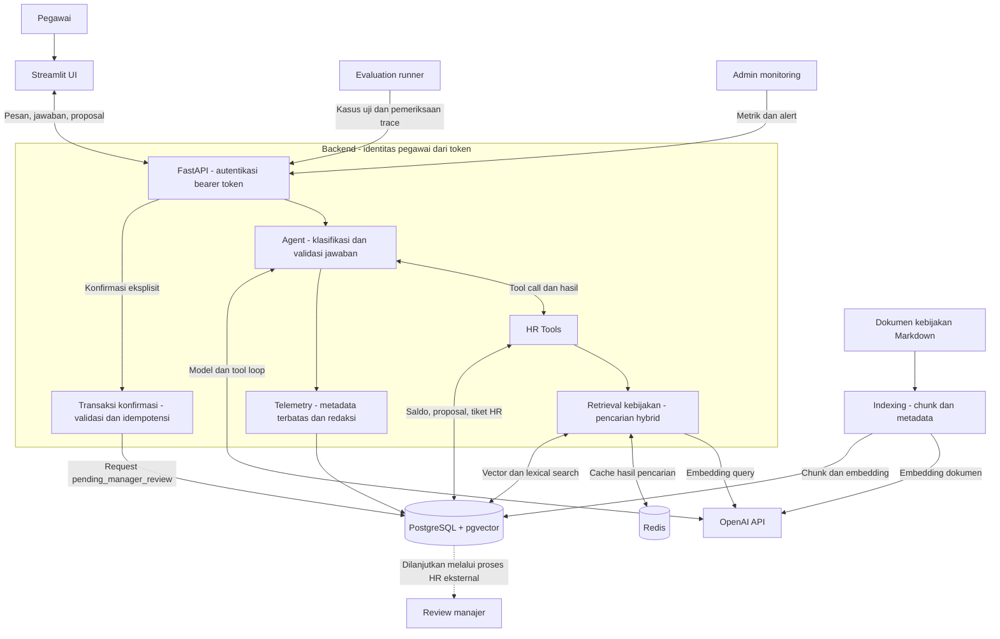

# High-Level Architecture

Asisten HR menjawab pertanyaan kebijakan dengan sumber, membaca saldo cuti, dan menyiapkan proposal cuti. Permintaan cuti baru dibuat setelah pengguna menekan tombol konfirmasi; persetujuan tetap dilakukan oleh manajer melalui proses HR di luar aplikasi.

## Alur utama

1. **Pertanyaan pengguna:** Streamlit mengirim pesan dan bearer token ke FastAPI. Backend menentukan identitas pegawai dari token, bukan dari teks pesan atau argumen model.
2. **Kebijakan dan saldo:** Agent menjalankan tool yang diperlukan. Pencarian kebijakan memakai embedding dan pencarian lexical, lalu menggabungkan serta mengurutkan hasil. Jawaban kebijakan harus menyertakan sitasi dari hasil pencarian pada run yang sama.
3. **Proposal cuti:** `prepare_leave_request` memvalidasi tanggal, saldo, pemberitahuan, dan benturan jadwal sebelum menyimpan proposal. Respons berisi `action_proposal`, yang membuat UI menampilkan tombol konfirmasi. Proposal belum membuat permintaan atau mengurangi saldo.
4. **Konfirmasi:** Klik pengguna memanggil endpoint konfirmasi secara langsung. Transaksi memeriksa kepemilikan, masa berlaku, dan aturan cuti kembali, lalu membuat satu permintaan `pending_manager_review`. Idempotency key mencegah duplikasi saat konfirmasi diulang. Tidak ada endpoint persetujuan manajer di aplikasi ini.

## Komponen pendukung

| Komponen | Peran |
| --- | --- |
| HR Tools | Mencari kebijakan, membaca saldo sendiri, menyiapkan proposal, dan membuat tiket konsultasi HR. |
| Policy indexing | Memecah dokumen Markdown menjadi chunk, membuat embedding, dan menyimpan index berversi sebelum digunakan untuk pencarian. |
| PostgreSQL + pgvector | Sumber data utama untuk identitas, saldo, proposal, permintaan, tiket, dokumen kebijakan, dan trace. |
| Redis | Cache hasil retrieval. Jika Redis gagal, pencarian tetap berjalan melalui embedding dan database, dengan latensi lebih tinggi. |
| Telemetry dan monitoring | Menyimpan metadata seperti status tool, sumber, token, biaya, dan latensi. Prompt serta payload model/tool mentah tidak disimpan dalam trace; error disaring dan diredaksi. Metrik agregat dibatasi untuk admin monitoring. |
| Evaluation runner | Mengirim kasus uji ke API dan memeriksa jawaban, trace, serta perubahan data. Runner tidak mengonfirmasi proposal. |

## Keputusan dan trade-off

- **UI terpisah dari backend:** semua akses data dan validasi berada di API, sehingga aturan yang sama berlaku untuk UI dan evaluator.
- **Model dibantu aturan deterministik:** model menangani bahasa dan pemilihan tool; backend tetap mengendalikan identitas, validasi, dan penyimpanan. Input cuti terstruktur yang dikenali dapat langsung menyiapkan proposal tanpa model.
- **Hybrid retrieval dengan cache:** meningkatkan cakupan pencarian dan mengurangi panggilan embedding berulang, dengan tambahan pengelolaan versi index dan cache.
- **Konfirmasi terpisah dari percakapan:** pengguna dapat meninjau proposal sebelum permintaan dibuat, dengan satu langkah tambahan sebelum review manajer.

Deployment lokal menggunakan empat service Docker Compose: Streamlit, FastAPI, PostgreSQL dengan pgvector, dan Redis. OpenAI API merupakan layanan eksternal.

