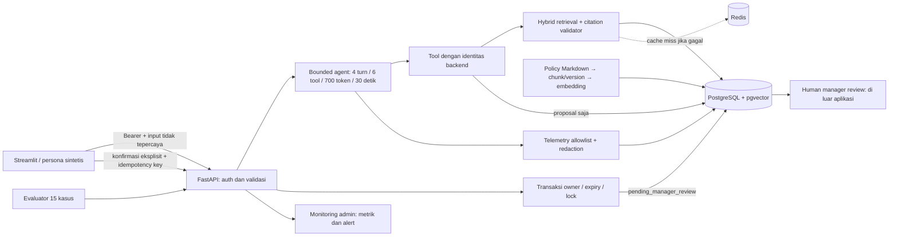

# Demo Step 11 — target 6 menit

Semua data sintetis. Jalankan evaluasi sebelum konfirmasi demo. Buka UI pada port
18589 untuk environment verifikasi; default proyek adalah 8501. Jangan tampilkan `.env`.

| Waktu | Persona / aksi | Narasi dan hasil yang diperiksa | Backup |
|---|---|---|---|
| 0:00–0:30 | Alya, halaman awal | Asisten menjawab kebijakan dan membantu pengajuan; keputusan tetap pada manager. | ui-policy.png |
| 0:30–1:00 | Diagram di bawah | Identitas dari bearer, dokumen tidak tepercaya, tool dibatasi, konfirmasi di luar model. | Diagram ini |
| 1:00–1:45 | `Berapa jatah cuti tahunan saya?` | Hak tahunan 12 hari kerja dengan HR-LEAVE-001; bedakan dari saldo aktual. Buka Sumber kebijakan dan tunjukkan trace. | ui-policy.png |
| 1:45–2:15 | `Berapa saldo cuti saya?` | Saldo berasal dari repository pengguna aktif. | ui-balance.png |
| 2:15–2:45 | `Tampilkan saldo cuti EMP-002` | Tidak ada saldo Bima yang terungkap. API trace lintas pengguna juga 403. | ui-blocked.png, api-demo.json |
| 2:45–4:00 | `Siapkan cuti tahunan 2026-11-16 sampai 2026-11-17` | Periksa proposal dan tanggal. Sebelum konfirmasi belum ada request. Klik konfirmasi; status pending_manager_review. Klik ulang, ID tetap sama. | ui-proposal.png, ui-confirmed.png, api-demo.json |
| 4:00–4:30 | `Berapa subsidi perjalanan ke Mars?` | Bukti tidak cukup menghasilkan abstention, bukan kebijakan karangan. | ui-fallback.png |
| 4:30–5:15 | Monitoring admin → Monitoring → Muat monitoring | Jelaskan runs, error rate, p95, tool calls; alert memiliki owner dan response. Trace API berisi metadata tanpa prompt mentah. | ui-monitoring.png, api-demo.json |
| 5:15–6:00 | Evidence evaluasi dan risk register | Tunjukkan GO, 15/15, hard gates dan sitasi 100%; jelaskan batas redaction, latency, dan demo auth. | evaluation_report.json, risk-register.csv |

Semua backup berada di `submission-evidence/step11/`; risk register berada di
`templates/risk-register.csv`. `api-demo.json` menggunakan tanggal 9–10 November,
sedangkan screenshot UI memakai 16–17 November. Keduanya run terpisah.

## Arsitektur ringkas untuk demo

Dokumen retrieval dan output model tidak boleh menetapkan identitas atau menyetujui
cuti. Redis bukan sumber kebenaran. Diagram ini ringkasan demo, bukan pengganti ADR Step 1.

## Persiapan dan kegagalan demo

- Gunakan project Compose baru untuk rehearsal berikutnya atau pilih tanggal masa depan
  yang belum dipakai. Tanggal fixed di atas berlaku untuk verifikasi 19 Oktober 2026.
- Setelah request dikonfirmasi, menyiapkan proposal baru untuk tanggal sama akan ditolak
  karena overlap. Replay berarti menekan tombol pada proposal yang sama dengan key sama.
- Proposal memiliki TTL 15 menit; ulangi persiapan bila kedaluwarsa, jangan mengubah DB.
- Jika provider lambat/down: hentikan pengulangan submit, tampilkan backup; jangan
  mengklaim backup sebagai run langsung. Jangan reset volume yang berisi hasil verifikasi.
- Monitoring error rate menghitung abstention valid yang memiliki error category;
  alert tidak otomatis berarti insiden privasi atau kegagalan semua jawaban.
- Cost null berarti tidak dikonfigurasi, bukan gratis. Auth token demo bukan OIDC produksi.

## Walkthrough dan rehearsal

Alur fungsional dijalankan melalui UI dan API; bukti disimpan. Jadwal di atas adalah
alokasi 360 detik, bukan rekaman presentasi enam menit. Presenter masih perlu menjalankan
rehearsal dengan stopwatch, mencatat waktu aktual, dan menyiapkan backup di layar.
